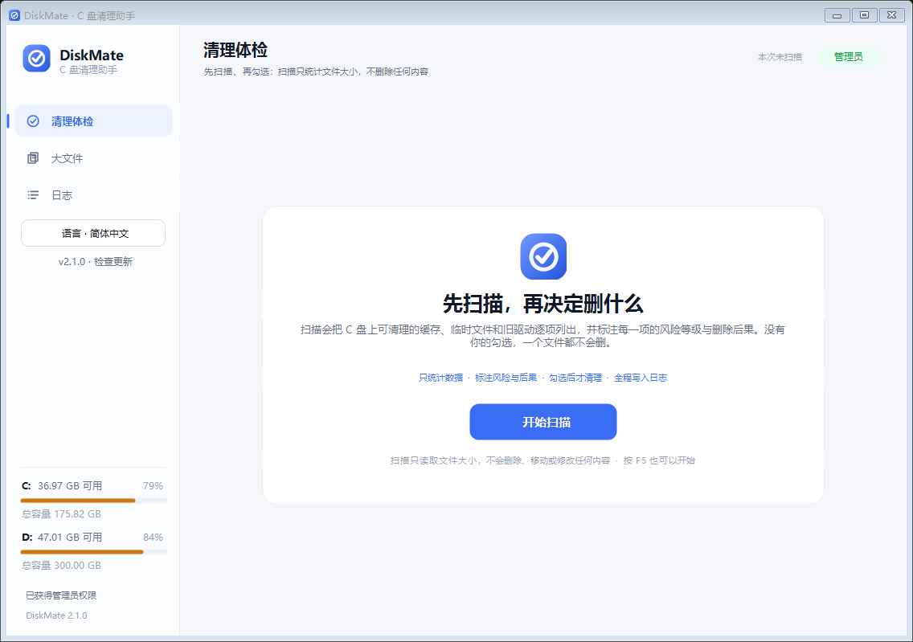

# DiskMate · C 드라이브 정리 도구

[简体中文](README.md) · [繁體中文](README.zh-TW.md) · [English](README.en.md) · [日本語](README.ja.md) · **한국어** · [Deutsch](README.de.md) · [Français](README.fr.md) · [Español](README.es.md) · [Português](README.pt.md) · [Русский](README.ru.md)

[](https://github.com/ankeji/DiskMate/actions/workflows/build.yml)
[](https://github.com/ankeji/DiskMate/releases)
[](LICENSE)

Windows 데스크톱용 C 드라이브 정리 도구입니다. **“스캔 시작”을 누르면 → 정리 가능한 항목을 하나씩 보여 주고 → 위험도와 삭제 결과를 표시하고 → 직접 선택한 뒤 → 확인 후 정리**합니다.

단일 exe, 설치 불필요, 추가 런타임 불필요(Windows 기본 .NET Framework 4.x만 사용).

**[최신 버전 다운로드](https://github.com/ankeji/DiskMate/releases/latest)** · **[문제 신고](https://github.com/ankeji/DiskMate/issues)**



## 특징

- **임의로 디스크를 건드리지 않습니다.** 실행하면 시작 화면에 머물며, “스캔 시작”(또는 F5)을 눌러야만 읽습니다.
- **스캔 취소 가능.** 13단계로 진행률을 보여 주고 언제든 취소할 수 있으며, 취소해도 아무것도 변경되지 않습니다.
- **3단계 위험도.** 항목마다 낮음/보통/높음과 “무엇이 지워지는지”, “지우면 어떻게 되는지”를 함께 표시하며 기본값은 낮은 위험만 선택됩니다.
- **지표 카드 4개.** 정리 가능 총량 · 낮음 · 보통 · 높음, 카드를 누르면 필터링됩니다.
- **오른쪽 상세 패널.** 삭제 영향, 권장 사항, 실제 경로, “폴더 열기”.
- **완전 자체 그리기 UI.** 기본 컨트롤과 외부 라이브러리를 쓰지 않아 어떤 DPI에서도 동일한 모양입니다.
- **10개 언어 지원**(기본은 중국어 간체). 전환 즉시 적용되고 다음 실행에도 유지됩니다.
- **앱 내 업데이트.** 왼쪽 아래 버튼 하나로 확인 → 다운로드 → 검증 → 교체 → 재시작.

## 페이지

| 페이지 | 내용 |
|---|---|
| 정리 점검 | 임시 파일, 업데이트 캐시, 로그, 휴지통, 최대 절전 파일, 오래된 드라이버 등 13단계 |
| 큰 파일 | 사용자 폴더와 대용량 폴더를 검사해 크기순 정렬 |
| 로그 | 스캔/정리 전체 기록(복사 가능) |

## 인터페이스 언어

| 언어 | 코드 | 범위 |
|---|---|---|
| 简体中文 | `zh-CN` | UI + 모든 항목 문구(기본) |
| 繁體中文 | `zh-TW` | UI + 모든 항목 문구 |
| English | `en-US` | UI + 모든 항목 문구 |
| 日本語 / 한국어 / Deutsch / Français / Español / Português / Русский | `ko-KR` 등 | UI 문구만(항목 설명은 영어로 대체) |

## 앱 내 업데이트

1. 왼쪽 아래에 `v2.1.0 · 업데이트 확인`이 항상 표시되며, 새 버전이 있으면 파란색 “v2.1.x로 업데이트”로 바뀝니다.
2. 누르면 버전 비교와 업데이트 내용을 보여 주고, “다운로드 및 설치”로 진행률과 함께 내려받습니다.
3. 완료 후 SHA-256으로 검증하고, 통과하면 교체 스크립트가 앱 종료 후 exe를 바꾸고 새 버전을 자동 실행합니다.

확인하는 배포처(더 높은 버전 채택):

- `https://raw.githubusercontent.com/ankeji/DiskMate/main/version.txt`
- `https://api.github.com/repos/ankeji/DiskMate/releases/latest`(예비, 미인증 시 60회/시간/IP)

릴리스는 한 줄: `powershell -ExecutionPolicy Bypass -File scripts\release.ps1 2.1.1 "수정 내용" "notes"`. 태그를 push하면 GitHub Actions가 빌드해 Release를 만듭니다.

## 빌드

Windows 10/11 기본 .NET Framework 4.x만 있으면 됩니다.

```bat
git clone https://github.com/ankeji/DiskMate.git
cd DiskMate
build.bat
```

`build.bat`은 시스템 `csc.exe`로 아이콘 없는 `_build.exe`를 빌드하고, `app.ico`를 생성한 뒤 아이콘을 포함해 `DiskMate.exe`를 다시 빌드합니다. Visual Studio도 NuGet도 필요 없습니다.

자체 점검: `DiskMate.exe --selftest`(페이지 렌더링, 겹침, 번역 누락 검사).

## 구성

```
DiskMate/
├── DiskMate.exe            빌드 결과물
├── build.bat               원클릭 빌드
├── version.txt             업데이트 매니페스트
├── src/                    소스(.cs 11개 + app.manifest)
├── .github/workflows/      CI 및 자동 릴리스
├── scripts/                push.bat · release.ps1
└── README*.md              10개 언어 문서
```

## 라이선스

MIT — [LICENSE](LICENSE) 참고.