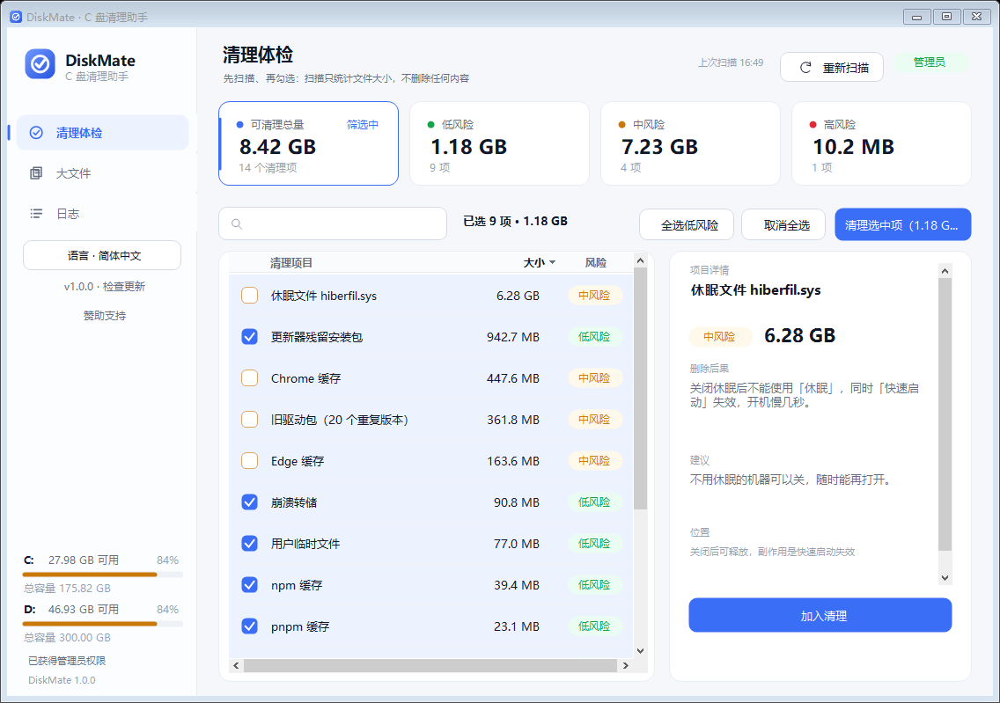
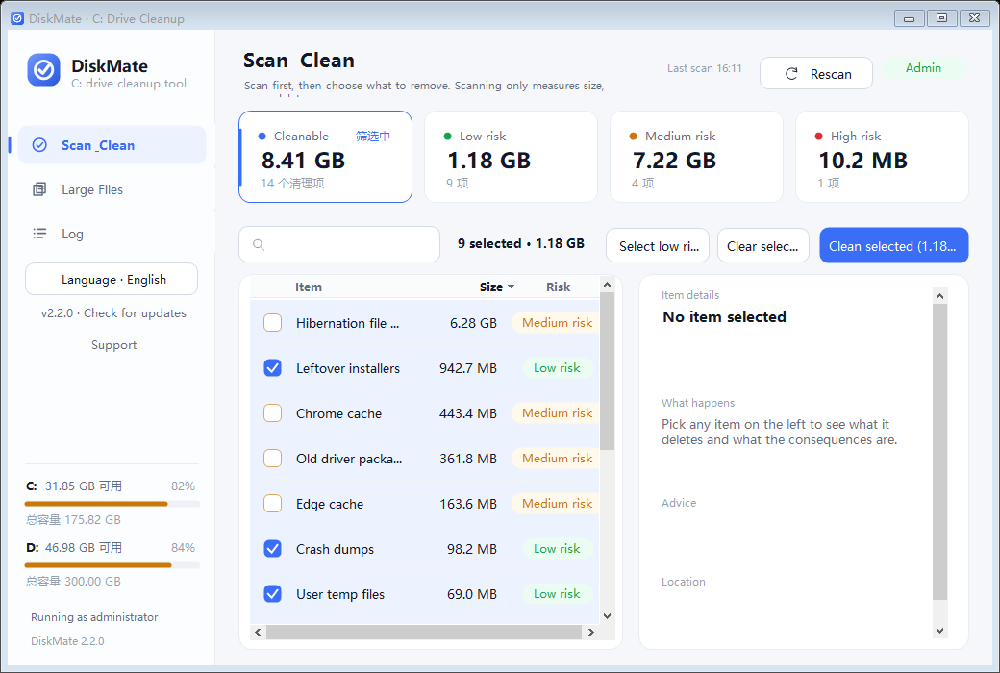
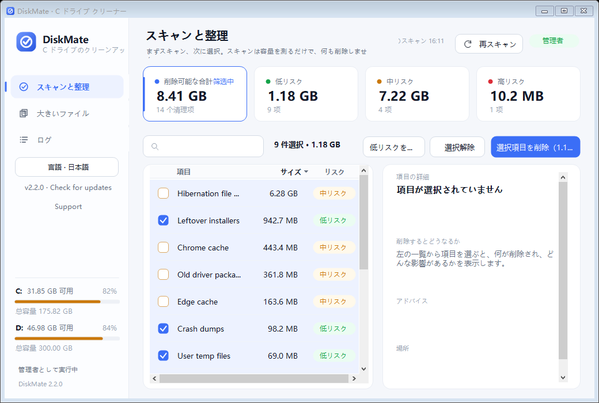
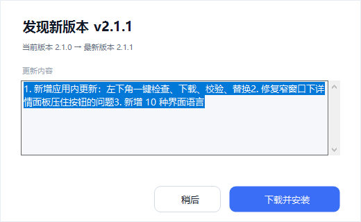

# DiskMate · C 盘管家

**简体中文** · [繁體中文](README.zh-TW.md) · [English](README.en.md) · [日本語](README.ja.md) · [한국어](README.ko.md) · [Deutsch](README.de.md) · [Français](README.fr.md) · [Español](README.es.md) · [Português](README.pt.md) · [Русский](README.ru.md)

[](https://github.com/ankeji/DiskMate/actions/workflows/build.yml)
[](https://github.com/ankeji/DiskMate/releases)
[](LICENSE)
[](#)

Windows 桌面 C 盘清理工具：**点「开始扫描」→ 逐项列出可清理内容 → 标注风险与删除后果 → 你自己勾选 → 确认后清理**。

单 exe，无安装、无运行库依赖（只用系统自带 .NET Framework 4.x）。

**[下载最新版](https://github.com/ankeji/DiskMate/releases/latest)** · **[问题反馈](https://github.com/ankeji/DiskMate/issues)**










---

## 一、交互流程

1. **启动只到欢迎页，不扫描**。程序打开后不会自动动磁盘，必须先点「开始扫描」（或按 F5）。
2. **扫描有进度、可取消**。界面显示当前统计到哪一项（共 13 步），随时可以「取消扫描」，取消后不会留下任何修改。
3. **结果页四张指标卡**：可清理总量、低风险、中风险、高风险。点卡片即按风险筛选，再点一次取消筛选。
4. **列表支持搜索、排序、勾选**：搜索框按名称/类别/说明过滤；点表头按项目/类别/大小/风险排序；空格键勾选当前行。
5. **右侧详情面板**：这一项会删掉什么、删除后果、建议、实际路径，可一键「打开所在文件夹」。
6. **清理前弹自定义确认框**：逐项列出名称、类别、大小、风险，并单独提示中/高风险条目。
7. **清理过程有进度**，完成后报告释放空间，并回收列表中已消失的项目，**不会自动重新扫描**（要不要复扫由你点「重新扫描」决定）。

快捷键：`F5` 开始/重新扫描，`Ctrl+F` 定位搜索框，`空格` 勾选当前行，`Esc` 关闭弹窗。

## 二、界面

- 左侧固定导航：清理体检 / 大文件 / 日志；底部常驻语言切换、检查更新（含当前版本号）、C、D 盘占用与权限状态。
- 品牌标志（圆角渐变方块 + 白色 C 环 + 对勾）由 `Logo.Draw()` 统一绘制，侧边栏、欢迎页和 `app.ico`（16–256 十个尺寸）共用同一份代码。
- 全自绘外观：圆角卡片、GDI+ 矢量图标（不依赖图标字体）、hover 反馈、Toast 式结果提示条。
- 主色 `#3B6EF6`，风险色 低 `#16A34A` / 中 `#CA7808` / 高 `#DC2D37`。
- 布局随窗口缩放自适应：`AutoScaleMode.Dpi` + 手动 `Resize` 布局，避免高 DPI 下控件重叠。
- 窄窗口下的降级：工具条先收窄搜索框（260 → 210 → 170），仍放不下才隐藏选中统计；列表宽度不足时自动收起「类别」列；详情正文放进可滚动区域，「加入清理 / 打开文件夹」固定在卡片底部，不会被文字压住。

## 三、风险分级

| 等级 | 含义 | 典型项目 |
|---|---|---|
| 🟢 低 | 只有缓存/临时文件，删了会自动重建 | 用户/系统临时文件、npm / Yarn / pnpm / pip / NuGet / Gradle 缓存、npm tarball、崩溃转储、更新器残留安装包、缩略图缓存、DirectX 着色器缓存、Prefetch、字体缓存 |
| 🟡 中 | 有副作用，但可恢复或影响有限 | Chrome / Edge 缓存（需先退出浏览器）、旧驱动包（不可回滚但保留最新版）、休眠文件（快速启动失效） |
| 🔴 高 | 数据不可恢复 | 回收站 |

默认只勾选低风险项，中高风险必须你自己点。

## 四、三个页面

- **清理体检**：欢迎页 → 扫描进度 → 结果（指标卡 + 搜索 + 列表 + 详情 + 底部操作条）
- **大文件**：阈值可选 100MB / 200MB / 500MB / 1GB，列出大文件，双击或「打开位置」在资源管理器中定位，只展示不删除
- **日志**：实时记录并落盘 `%LOCALAPPDATA%\DiskMate\logs\diskmate-yyyyMMdd.log`，可一键复制 / 打开目录

> 旧的「高级清理」页已删除：旧驱动、休眠文件、回收站本来就是扫描项（在清理体检里带风险说明和勾选），DISM / 更新缓存的独立入口与清理体检重复，一并去掉。

## 五、多语言

界面支持 10 种语言，**默认简体中文**，切换入口在左侧栏底部「语言 · 简体中文」：

| 语言 | 代码 | 语言 | 代码 |
|---|---|---|---|
| 简体中文（默认） | `zh-CN` | Français | `fr-FR` |
| 繁體中文 | `zh-TW` | Español | `es-ES` |
| English | `en-US` | Português | `pt-BR` |
| 日本語 | `ja-JP` | Русский | `ru-RU` |
| 한국어 | `ko-KR` | Deutsch | `de-DE` |

- 切换即时生效（不重启）：控件文本通过 `Tag = i18n key` 挂载，`Retext()` 重放一遍，列表、详情、指标卡、日志页按钮一起刷新。
- 查找顺序：当前语言 → 英文 → 简体中文 → key 本身，任何缺词都不会显示成空白。
- 清理项的名称 / 类别 / 删除后果 / 建议按 `item.<key>.*` 取词；简体中文、繁體中文、English 为全量翻译，其余语言界面全量、清理项正文回退英文。
- 选择结果写入 `%LOCALAPPDATA%\DiskMate\settings.ini`（不可写时退回 exe 同目录 `settings.ini`），下次启动沿用。
- 仓库里的文档同样分语言：`README.md`（简中）· `README.zh-TW.md` · `README.en.md` · `README.ja.md` · `README.ko.md` · `README.de.md` · `README.fr.md` · `README.es.md` · `README.pt.md` · `README.ru.md`，每篇顶部都有语言切换链接。
- 加一门语言：在 `src/I18n.cs` 的 `Codes` 里加代码、`NativeName` 里加显示名、`AddUpdate()` 的表里补词条，界面和语言菜单自动出现（`src/LangMore.cs` 是批量词条的另一个入口）。

## 六、应用内更新

用户不用重新下载安装包，直接在界面里升级：

- 左下角常驻 `v2.1.0 · 检查更新`，发现新版本时变成蓝色「更新到 v2.1.x」。
- 启动 2.5 秒后静默查一次，有新版本只弹一条提示条，不打扰使用。
- 点按钮 → 弹窗显示「当前版本 → 最新版本」+ 更新说明 → 「下载并安装」→ 进度条 → SHA-256 校验 → 启动替换脚本 → 程序退出 → 几秒后新版自己打开。


### 检查顺序（两条源，取版本更高的那个）

| 顺序 | 源 | 地址 | 特点 |
|---|---|---|---|
| 1 | 仓库里的 `version.txt` | `https://raw.githubusercontent.com/ankeji/DiskMate/main/version.txt` | 无频率限制，正常发版走这里 |
| 2 | GitHub Releases API | `https://api.github.com/repos/ankeji/DiskMate/releases/latest` | 兜底：`version.txt` 没更新也能发现新版本；未登录限 60 次/小时/IP |

两条源都失败才算检查失败；任一条返回更高的版本号就用它。想换成自己的服务器，只改 `src/Update.cs` 里的 `ManifestUrl`。

`version.txt` 格式（UTF-8，一行一个 `key=value`，`#` 开头是注释）：

```ini
version=2.1.1
url=https://github.com/ankeji/DiskMate/releases/download/v2.1.1/DiskMate.exe
sha256=0C26A3724DDD27449566199E167E3DCD33C13073ADD0239053D58B3466480E14
size=340480
date=2026-11-06
notes.zh=1. 新增应用内更新\n2. 修复窄窗口布局
notes.en=1. In-app updates\n2. Fixed narrow-window layout
```

| 字段 | 说明 |
|---|---|
| `version` | 必须，比当前版本大才会提示；`2.1.1` / `2.2` 都能解析 |
| `url` | 必须，绝对地址，或与清单同目录的相对文件名 |
| `sha256` | 可选，填了就强校验，不匹配立即中止（推荐填） |
| `size` | 可选，服务器不返回 Content-Length 时用来算进度 |
| `notes.<lang>` | 可选，按界面语言取，取不到回退 `notes.en`；`\n` 表示换行 |

### 发版（三种方式，任选）

**A. 一条命令（推荐）**

```bat
powershell -ExecutionPolicy Bypass -File scripts\release.ps1 2.1.1 "修复窄窗口布局" "Fixed narrow-window layout"
```

脚本会：改 `src/Update.cs` 里的版本号 → 编译 → 跑自检 → 生成 `version.txt` → 提交 → 打 tag `v2.1.1` → 推送。
推送后 GitHub Actions（`.github/workflows/release.yml`）自动编译、跑 `--selftest`、创建 Release（附 `DiskMate.exe` + `version.txt`），再把 `version.txt` 提交回 `main`。

> 仓库配置、token、代理、CI 排错的完整说明见 [`docs/GITHUB-SETUP.md`](docs/GITHUB-SETUP.md)。

**B. 手动打带说明的 tag**

```bat
git tag -a v2.1.1 -F docs\release-notes-v2.1.1.md
git push origin v2.1.1
```

标签说明会被 Actions 取出来，同时写进 Release 正文和 `version.txt` 的 `notes.zh` / `notes.en`，用户在更新弹窗里看到的就是它。

**C. 完全手动**

1. 改 `src/Update.cs` 的 `AppInfo.Version`，`build.bat`；
2. 在 GitHub 上新建 Release，tag 写 `v2.1.1`，上传 `DiskMate.exe`；
3. 生成本地清单并提交：

```bat
DiskMate.exe --writeversion=version.txt|https://github.com/ankeji/DiskMate/releases/download/v2.1.1/DiskMate.exe|1. 修复A\n2. 修复B|1. Fixed A\n2. Fixed B
git add version.txt && git commit -m "chore: version.txt for v2.1.1" && git push
```

### 实现要点（`src/Update.cs`）

- **替换方式**：运行中的 exe 无法自我覆盖，所以程序生成一个纯 ASCII 批处理：等旧进程退出 → `copy /y` 覆盖（最多重试 60 次 × 1 秒）→ `start` 拉起新 exe → 自删；失败留下 `<新文件>.failed` 记录尝试次数。
- **权限**：exe 的 manifest 是 `requireAdministrator`，子进程继承管理员令牌，覆盖 `Program Files` 下的旧文件不会再弹一次 UAC。
- **TLS**：主动把 `ServicePointManager.SecurityProtocol` 设为 TLS 1.2（老 .NET 默认只开 TLS 1.0 / SSL3）。
- **JSON**：`src/Json.cs` 是 100 行的手写解析器，专门解 GitHub 的返回，避免引入任何第三方库。
- **下载位置**：`%TEMP%\DiskMate-update\`，不可写（受限权限、绿色运行）时退回 exe 同目录 `update-cache\`。
- **校验**：边下边写，下完算 SHA-256 再比对，通不过直接中止，坏文件不会换上去。
- **Release 说明里的约定**：`<!--notes-->…<!--/notes-->` 之间的内容作为更新说明显示；`sha256: xxxx` 一行可提供校验值；`exe: https://…` 一行可指定下载地址（没有资产时）。

### 命令行自测

```bat
DiskMate.exe --checkupdate                                            :: 查两个源，打印版本/地址/哈希
DiskMate.exe --checkupdate --update-url=file:///D:/dist/release.json   :: 用本地 JSON 模拟 GitHub 返回
DiskMate.exe --updatetest --update-url=file:///D:/dist/version.txt     :: 查 + 下载 + 校验
DiskMate.exe --installtest=D:\dist\new.exe|D:\dist\target.exe          :: 只测替换脚本（不重启）
DiskMate.exe --writeversion=out.txt|https://…/DiskMate.exe|说明|notes   :: 生成清单
```
## 七、使用

```
双击 DiskMate.exe     → 会弹 UAC（驱动和系统级清理需要管理员）
```

无界面自检（只扫描、不删除，并渲染各语言的界面截图 + 控件重叠检测）：

```
DiskMate.exe --selftest
```

会在 exe 目录生成 `screenshot.png`、`_render-results.png`、`_render-small.png`、`_render-en.png`、`_render-ja.png`，并在 `%TEMP%\diskmate-selftest.txt` 写入扫描结果、控件重叠与语言切换结果：

```
admin: yes
items: 14
  [中] 休眠文件 hiberfil.sys             6.28 GB  系统
  [低] 更新器残留安装包                     942.7 MB  应用
  [中] 旧驱动包（20 个重复版本）               361.8 MB  系统
  ...
total: 8.23 GB
--- i18n: en-US ---
  nav=Scan & Clean / Large Files / Log
  bar=Select low risk | Clear selection | Clean selected (1.10 GB) | Rescan
```

其它命令：

```
DiskMate.exe --makeicon app.ico   生成多尺寸图标
DiskMate.exe --langtest           打印 10 种语言的抽查词条
```

## 八、从源码编译

需要 Windows 自带的 .NET Framework 4.x（Win10/11 默认都有）：

```bat
git clone https://github.com/ankeji/DiskMate.git
cd DiskMate
build.bat
```

脚本调用 `%WINDIR%\Microsoft.NET\Framework64\v4.0.30319\csc.exe` 三步走：先编译出无图标的 `_build.exe` → 用它生成 `app.ico` → 带 `/win32icon` 重新编译 `DiskMate.exe`。无需 Visual Studio、无需 NuGet。

`build.bat /nopause` 给 CI 用（结束时不停在 pause）。

推送代码到自己的仓库：

```bat
scripts\push.bat
```

> 国内网络推送失败时先挂代理：`git config --global http.proxy http://127.0.0.1:7890`（端口换成你自己的）。
> 也可以用 `git bundle` 离线搬运：`git bundle create DiskMate.bundle --all`，另一台机器 `git clone DiskMate.bundle`。

CI：`.github/workflows/build.yml` 每次 push 编译 + 自检；`.github/workflows/release.yml` 打 `v*` tag 时自动发 Release。

## 九、目录结构

```
DiskMate/
├── DiskMate.exe            编译产物（双击运行）
├── app.ico                 程序图标（由 --makeicon 生成，构建时嵌入）
├── build.bat               一键编译（csc，无依赖）
├── screenshot.png          欢迎页截图
├── screenshot-results.png  结果页截图（默认窗口 / 最小窗口）
├── screenshot-small.png
├── screenshot-en.png       英文界面
├── screenshot-ja.png       日文界面
├── screenshot-update.png   更新弹窗
├── version.txt             更新清单（发版时由 CLI / CI 生成）
├── LICENSE                 MIT
├── docs\                   发版说明模板 / 各版本更新内容
├── .github\workflows\      build.yml（CI）· release.yml（打 tag 自动发版）
├── scripts\                push.bat（推送）· release.ps1（一键发版）
├── src\
│   ├── DiskMate.cs         模型 / 主题 / 矢量图标 / 文件引擎
│   ├── Controls.cs         自绘控件：卡片、按钮、导航、指标卡、进度、搜索框、列表
│   ├── Dialogs.cs          无边框消息框 / 清理确认框
│   ├── I18n.cs             多语言核心 + 简中 / 繁中 / 英文词条
│   ├── LangMore.cs         日语 / 韩语 / 德语 / 法语 / 西语 / 葡语 / 俄语词条
│   ├── Logo.cs             品牌标志绘制 + 多尺寸 ICO 生成
│   ├── Update.cs           版本号 / 清单解析 / 下载 / SHA-256 校验 / 替换脚本
│   ├── UpdateDialog.cs     更新弹窗（版本对比 + 更新说明 + 下载进度）
│   ├── Pages.cs            三个页面的构建 + 扫描步骤表 + 风险表
│   ├── MainForm.cs         外壳、导航、语言切换、扫描与清理流程、排序筛选
│   ├── Program.cs          入口 + --selftest / --makeicon / --langtest
│   └── app.manifest        requireAdministrator + DPI 感知
├── README.md               简体中文（主）
└── README.zh-TW / .en / .ja / .ko / .de / .fr / .es / .pt / .ru.md   其他语言
```

## 十、代码结构

| 成员 | 作用 |
|---|---|
| `BuildScanSteps()` | 扫描步骤表：13 个 `ScanStep`，每步一个标签 + 一段统计逻辑，驱动进度显示 |
| `AddDir(...)` | 统计一组目录大小并登记成 `CleanItem`，支持中途取消 |
| `AssignRisk(list)` | **风险表**：按 Key 给每项打等级、写后果和建议，并决定默认勾选；末尾调用 `LocalizeItem()` 换成当前语言 |
| `I18n.T / I18n.F` | 取词与格式化，查找顺序 当前语言 → 英文 → 简中 → key |
| `Txt(control, key)` / `Retext()` | 给控件挂 i18n key；切换语言时重放全部文本、列表列头、指标卡与详情 |
| `Logo.Draw / Logo.SaveIco` | 标志绘制与 16–256 多尺寸 ICO 生成 |
| `UpdateService.Check()` | 先读 version.txt 再问 GitHub API，取版本更高的那个 |
| `UpdateService.Download/Verify/RunInstaller` | 带进度下载、SHA-256 校验、生成延迟替换脚本（等旧进程退出再覆盖） |
| `MiniJson` | 100 行手写 JSON 解析器，解析 `tag_name` / `assets` / `body` |
| `UpdateService.WriteManifest()` | `--writeversion` 用：以当前 exe 生成 version.txt（含 sha256 / size） |
| `UpdateDialog` | 更新弹窗；下载与校验在后台线程，进度回主线程 |
| `BeginScan()` / `CancelScan()` | 后台扫描 + UI 线程进度回调 + 取消标志 |
| `StartClean()` / `Execute()` | 逐项清理、汇报进度、结束后回测剩余大小并更新列表 |
| `BuildDriverPlan()` / `PruneDrivers()` | 解析 `pnputil /enum-drivers`，同名驱动只留最新，估算可释放空间 |
| `Engine.DirSize/ClearDir/Run` | 手写遍历（跳过重解析点，占用文件不抛异常）；进程输出异步读取，避免管道死锁 |

### 加一个清理项（三步）

```csharp
// 1. Pages.cs 的 BuildScanSteps() 里加一步（或并进已有步骤）
steps.Add(new ScanStep("我的软件缓存", delegate(List<CleanItem> l)
{
    AddDir(l, "mycache", "我的软件缓存", "开发",
           new[] { Path.Combine(local, "MyApp", "cache") }, "缓存文件，会按需重建");
}));

// 2. Pages.cs 的 AssignRisk() 里给风险和后果
case "mycache":
    it.Risk = 0;
    it.Impact = "缓存文件，删了下次启动自动重建。";
    it.Advice = "放心删。";
    break;

// 3. 如果不是「清空某个目录」，再到 MainForm.Execute() 里加一个 Kind 分支
// 4. （可选）I18n.cs 里补 item.mycache.name / .impact / .advice 三个词条，界面即可多语言
```

## 十一、安全边界

- 只删**缓存与临时文件**目录内容，不碰 `Documents`、`Desktop`、`Pictures`、聊天记录、已安装程序
- 驱动只删重复旧版本，**不使用 `/force` / `/uninstall`**，正在使用的驱动由系统拒绝
- 所有破坏性操作都有二次确认，并完整列出明细
- 扫描阶段只读文件大小，不写、不删、不移动
- 每一步写入日志；未捕获异常写入 `crash-yyyyMMdd-HHmmss.log`，便于定位

## 十二、已知限制

- 浏览器缓存需先退出浏览器，否则被占用的文件会被跳过（日志会写跳过数量）
- `WinSxS\Temp` 属于 TrustedInstaller，正常管理员也删不掉；DISM 组件清理的独立入口已随「高级清理」页一起删除，需要时手动运行 `dism /Online /Cleanup-Image /StartComponentCleanup`
- 日 / 韩 / 德 / 法 / 西 / 葡 / 俄仅界面全量翻译，清理项的正文回退英文（词条在 `I18n.cs`，补 `item.<key>.name/impact/advice` 即可本地化）
- 大文件扫描不进入 `C:\Windows` 与 `WinSxS`，避免长时间等待
- 扫描读的是文件大小，与「资源管理器显示的占用」可能有少量差异（硬链接、稀疏文件）
- 应用内更新是整包替换：exe 只有约 300 KB，没做增量差分；放在无写权限目录、或用户拒绝 UAC 时替换会失败并留下 `*.failed` 记录
- 更新只覆盖 exe 本体，`settings.ini` / 日志 / 用户数据都保留
