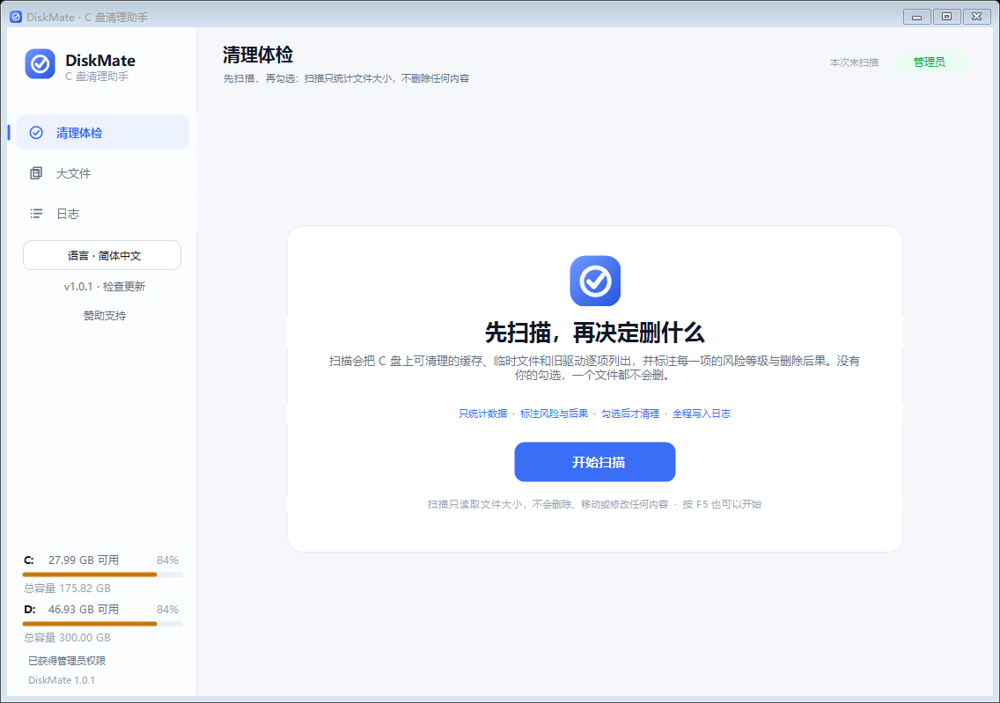

<!--
Title: Building a Windows cleaner that refuses to guess
Description: How DiskMate avoids deleting the wrong thing: a fixed whitelist of paths, read-only scanning that skips reparse points, Recycle Bin by default, and what I learned from 38 files that returned error 5.
Canonical: https://github.com/ankeji/DiskMate
-->

# Building a Windows cleaner that refuses to guess

A disk cleaner is one of the few categories of software where users voluntarily hand over full administrator rights to a program whose entire job is deleting files. That is also why the category has such a bad reputation: the incentives are terrible, the failure mode is unrecoverable, and "one click, 3.2 GB freed" is a much better screenshot than "we checked carefully and did nothing."

I wrote [DiskMate](https://github.com/ankeji/DiskMate) because I wanted a cleaner I could actually read the source of. It is C# / WinForms, about 14,000 lines, ships as a single 1.1 MB exe, and does nothing but delete from a list of paths I typed by hand.

This post is about the parts that are not UI: how the tool decides what is junk, how scanning stays read-only, and the specific bugs that taught me where "safe deletion" actually breaks.

## The only design decision that matters

There are two ways to build a cleaner.

The first is pattern matching: walk the disk, flag anything named `*.tmp`, `*.log`, `cache`, `~*`, anything older than N days. This scales beautifully and is how a lot of tools end up eating someone's project folder. It also cannot tell you *why* a file is safe to delete, because the rule was "it looked like junk."

The second is a closed list: the program knows 17 specific cleanup targets, each with an explicit set of directories. Nothing outside that list is ever touched, no matter how junky it looks.

DiskMate is the second kind. Every entry is written out by hand:

```csharp
AddDir(l, "temp-user", "User temp files", "temp",
       new[] { Path.Combine(local, "Temp") },
       "Created by running programs, safe to remove at any time");

AddDir(l, "npm", "npm cache", "dev",
       new[] { Path.Combine(roaming, "npm-cache"), Path.Combine(local, "npm-cache") },
       "Rebuilt automatically the next time you install dependencies");
```

The 17 entries cover user and system temp, npm / Yarn / pnpm / pip / NuGet / Gradle caches, crash dumps, leftover installer packages from app updaters, Chrome and Edge cache, thumbnail and icon cache, DirectX shader cache, Prefetch, font cache, old driver packages, the hibernation file, and the Recycle Bin itself.

Thirteen scan steps, each of which can be skipped, cancelled, or fail without taking down the rest of the scan.

The upside of a closed list is that it is auditable: you can read the file and see every path the program is capable of touching. The downside is that it will never find the 40 GB in a folder you forgot about. I think that trade is correct for a tool that runs elevated, but it does mean the app is not a "find everything" tool, and I would rather say that up front than ship a heuristic that occasionally guesses wrong.

## Risk is a property of the entry, not a guess

Every entry carries a risk level, an explanation of what happens if you delete it, and a recommendation. These are attached in one place, so there is exactly one answer to "is this safe":

```csharp
case "npm":
case "yarn":
case "pnpm":
    it.Risk = 0;
    it.Impact = "Only package caches are removed. The next install re-downloads them, " +
                "which is slower but does not affect installed projects.";
    it.Advice = "Safe to delete; keep it if your network is slow.";
    break;
```

Risk 0 is cache that rebuilds itself. Risk 1 has a side effect you can live with: browser cache requires closing the browser first, old driver packages cannot be rolled back afterwards, deleting `hiberfil.sys` disables fast startup. Risk 2 is unrecoverable, and currently that is only the Recycle Bin.

Only risk 0 items are pre-checked. Risk 1 and 2 require a deliberate click, and the confirmation dialog lists every item, its size, and its impact before anything happens.



That screenshot is the Chinese UI; the app ships 10 languages. More on that in the rough edges section.

## Scanning never writes

The scan phase opens files, reads `FileInfo.Length`, and does nothing else. No writes, no moves, no deletes, no "optimization." The scan result is a size, a count, and a note.

Two details turned out to matter more than I expected.

**Iterative traversal, not recursion.** A recursive `Directory.GetFiles(..., AllDirectories)` on `C:\Users` will happily blow the stack on a deeply nested `node_modules`, and one `UnauthorizedAccessException` aborts the whole subtree. DiskMate uses an explicit stack and catches per-directory and per-file:

```csharp
foreach (string f in Directory.EnumerateFiles(dir))
    try { total += new FileInfo(f).Length; } catch { }
```

A single locked 4 GB file should not invalidate the other 200,000 files in the scan.

**Reparse points are skipped.** This one is not about correctness of the number, it is about not walking into somewhere you did not intend to go:

```csharp
var di = new DirectoryInfo(d);
if ((di.Attributes & FileAttributes.ReparsePoint) != 0) continue;
stack.Push(d);
```

Windows is full of junctions and symlinks: `C:\Documents and Settings` points at `C:\Users`, `C:\ProgramData\Application Data` points at itself, and plenty of tools create directory links into other volumes. Following them double-counts, can loop forever, and — if the deletion code ever followed the same path — could delete files on a completely different drive. Skipping reparse points makes the traversal a tree instead of a graph.

There is a second, separate measurement pass that classifies bytes as *deletable now* versus *blocked*. Blocked means the file exists but cannot be opened or deleted (in use, or ACL-protected). Those bytes are reported separately and never counted as reclaimable:

```
12.4 GB in this category; another 380 MB in 41 files is in use and was not counted
```

That number is the difference between "we freed 12.4 GB" and "we said we would free 12.8 GB and you got 12.4."

## Deletion goes through the Recycle Bin

The default delete path is `SHFileOperation` with `FOF_ALLOWUNDO`, in batches of 100 files:

```csharp
op.fFlags = (ushort)(Native.FOF_ALLOWUNDO | Native.FOF_NOCONFIRMATION |
                     Native.FOF_SILENT | Native.FOF_NOERRORUI);
```

`FOF_ALLOWUNDO` sends files to the Recycle Bin, which is the only recovery mechanism a user actually has. Permanent deletion exists, but it is a separate, explicitly confirmed action, and the dialog says "this cannot be undone" rather than hiding it behind a checkbox.

After each batch, the result is not taken from the API return value. It is measured:

```csharp
Engine.RecycleFiles(part, log);
for (int j = 0; j < n; j++)
{
    if (!File.Exists(part[j])) freed += sizes[j];
    else failed++;
}
```

`SHFileOperation` returns success even when shell extensions silently skip files, so the honest number is "how many of these paths no longer exist, multiplied by the size we recorded before." If it says 2.1 GB, 2.1 GB of files are gone.

## The error 5 rabbit hole

This is the part where I learned that "delete a file" on Windows is not one operation.

The first symptom: 38 files in a WeChat cache folder refused to delete, every one returning `ERROR_ACCESS_DENIED` (5). The files were read-only, and WeChat's cache is genuinely hostile: `.dat` blobs with the read-only bit set, held open by the client.

Clearing `ReadOnly` before deleting fixed most of it. The rest failed inside the elevation path, because `takeown` itself was failing — and that turned out to be a WOW64 problem. The exe is AnyCPU, so on some machines it runs as a 32-bit process, and for a 32-bit process the file system redirects `%WINDIR%\System32` to `SysWOW64`, which does not contain `takeown.exe` at all:

```
%WINDIR%\System32\  -> silently redirected to SysWOW64 for a 32-bit process
%WINDIR%\SysWOW64\  -> no takeown.exe, no icacls.exe
%WINDIR%\Sysnative\ -> the real System32, and only reachable from a 32-bit process
```

`File.Exists(@"C:\Windows\System32\takeown.exe")` returns **true** from a 32-bit process and then `CreateProcess` fails, because the file it actually looked at does not exist. Resolving `%WINDIR%\Sysnative\` first, and falling back to `System32`, fixed the ownership step.

The last 38 files still failed. Not because of permissions, and not because of the read-only bit — because 14 WeChat processes (`Weixin.exe` ×5, `WeChatAppEx.exe` ×9) were holding handles. The user had closed the window, not the processes. The app now detects that case and offers to close them and retry, instead of reporting a permission error that sends people down the ACL path for an hour.

The general lesson: on Windows, "access denied" almost never means "wrong permissions." It usually means "the file is open somewhere," and the error code will not tell you where.

## Detecting "in use" when Restart Manager won't cooperate

The supported API for "which process is holding this file" is the Restart Manager (`RmStartSession` / `RmRegisterResources` / `RmGetList`). I wired up the P/Invoke, and `RmStartSession` returned 29 on every call, with every signature variation I tried: four different struct layouts, `uint` vs `int` handles, `RmSessionHandle` as `IntPtr` vs `uint`. The same call from Python `ctypes` with the same arguments worked fine, which is the kind of thing that makes you question your career choices.

I gave up on Restart Manager and used a cheaper trick: open the file exclusively and see what happens.

```csharp
IntPtr h = CreateFileW(path, GENERIC_READ, 0 /* no sharing */,
                       IntPtr.Zero, OPEN_EXISTING, FILE_ATTRIBUTE_NORMAL, IntPtr.Zero);
if (h == INVALID_HANDLE_VALUE)
{
    int err = Marshal.GetLastWin32Error();
    if (err == 32 || err == 33) return true; // SHARING_VIOLATION / LOCK_VIOLATION
}
```

This cannot tell you *which* process holds the file, but it answers the only question the UI needs: can this be deleted right now, yes or no. For the process name, the app checks whether WeChat is running at all and says "WeChat (Weixin.exe / WeChatAppEx.exe) is holding these files" rather than pretending to be precise.

## What it deliberately does not do

- It does not scan the whole disk for junk. It touches 17 fixed targets and nothing else.
- It does not touch `Documents`, `Desktop`, `Pictures`, chat history, or installed programs.
- It does not touch `WinSxS`. That directory is owned by TrustedInstaller, an administrator cannot delete from it anyway, and tools that try tend to produce machines that no longer boot.
- It does not install a service, add a startup entry, or run in the background.
- It has no telemetry. The only network requests are an update check against a static `version.txt` in the GitHub repo, and the optional account system for posting feedback.
- It does not offer "optimization," "registry cleaning," or "RAM boosting," because I cannot verify that any of those do anything.

The large-file scanner intentionally skips `C:\Windows` and `WinSxS` for the same reason: a scan that takes eleven minutes is a scan people cancel halfway.

## Rough edges, honestly

**It requires administrator rights at launch.** The manifest is `requireAdministrator`, not `asInvoker` with on-demand elevation. Cleaning `SoftwareDistribution\Download` and `Prefetch` needs it, and I judged that one UAC prompt at startup is better than a UAC prompt in the middle of a delete loop. But it does mean you are trusting the binary before you have seen it do anything, which is exactly the trust problem this category has.

**It is not code-signed.** A code signing certificate costs more than this project will ever earn, so SmartScreen will show "Windows protected your PC" on first run. The honest workaround is to check the SHA-256 against the release notes, or build it yourself: it is plain `csc.exe` with a `build.bat`, no NuGet, no MSBuild.

**.NET 4.0 and C# 5.** Ancient by 2026 standards. It buys Windows 7 compatibility and "double-click and it runs" with no runtime install. It also means no `async`/`await` in the codebase, which is why the scanning code looks the way it does.

**Language detection arrived late.** Until 1.1.1 the UI opened in Simplified Chinese no matter what your system spoke, with the switcher sitting quietly in the bottom-left corner. Preparing this post made me look at the first thirty seconds from an English user's perspective, and what I found was embarrassing: six places where English text overflowed or leftover Chinese peeked through — fixed-width toolbar buttons, a hard-coded "筛选中" badge, notes that were never routed through the translation table. All of it is fixed as of 1.1.2, and the app now opens in Simplified or Traditional Chinese only when the system is Chinese, English otherwise; a manually picked language still wins.

**No incremental updates.** The updater replaces the whole exe. At 1.1 MB that is fine; if the app ever grows, it will not be.

## Why the source is the feature

Every cleaner asks for the same thing: administrator rights and permission to delete. The only way to evaluate that request is to read what it does, which means the source has to be there, or the claim "we only delete caches" is just marketing.

The whole thing is a single `build.bat` and a `src/` folder. If you want to check whether it touches something it should not, the entire deletion surface is one file, and every path it can reach is written out as a literal.

## What I would like to hear

Three things I genuinely do not know:

1. **Which directories am I missing?** The list is 17 entries deep and shaped by my own machines. If you know a cache location that is both safe and large, that is the most useful comment you can leave.
2. **How do you handle "access denied" on Windows?** My fallback chain is clear attributes → retry → take ownership → exclusive-open probe → offer to close the holder. It works, but it feels like a pile of heuristics rather than a design.
3. **Is this still worth building in 2026?** Windows 11's Storage Sense exists, and it is free and signed by Microsoft. My answer is that it does not tell you what it is about to delete, and it does not handle per-app caches like WeChat's. I am not certain that is enough of a reason.

Source and releases: [github.com/ankeji/DiskMate](https://github.com/ankeji/DiskMate) · [latest release](https://github.com/ankeji/DiskMate/releases/latest)

Windows 7 SP1 and later, x86 and x64, single 1.1 MB exe, no installer.

---

<!--
Author's first comment — post this as a reply on your own Show HN submission, not in the article.

Two things I left out of the post because they are boring but relevant:

- The scan is single-threaded on purpose. Parallelizing it across 17 small targets made the progress bar lie (it jumped from 3% to 90%) and added almost nothing, because the bottleneck is metadata IO on a few large directories, not CPU.
- "Free space" reported by this app will differ slightly from Explorer's number. Hard links and sparse files mean the sum of file sizes is not the space you get back. I report the sum of sizes, and I say so in the docs, because the alternative is a number that looks precise and is wrong.

Happy to answer anything about the Win32 side — the Sysnative redirect and the Restart Manager failure were the two things that cost me the most time.
-->
